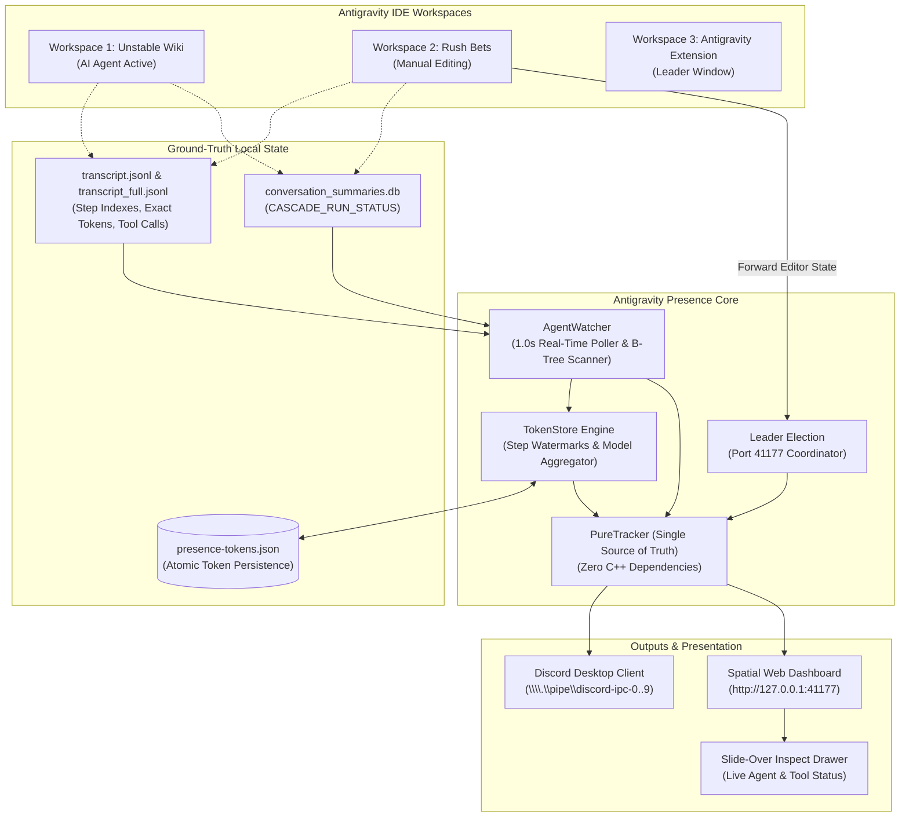
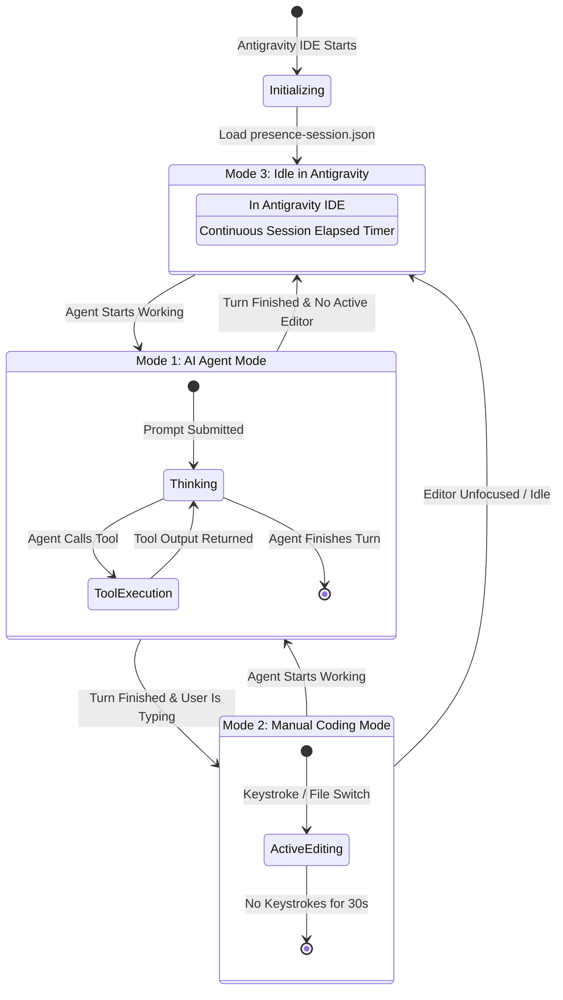
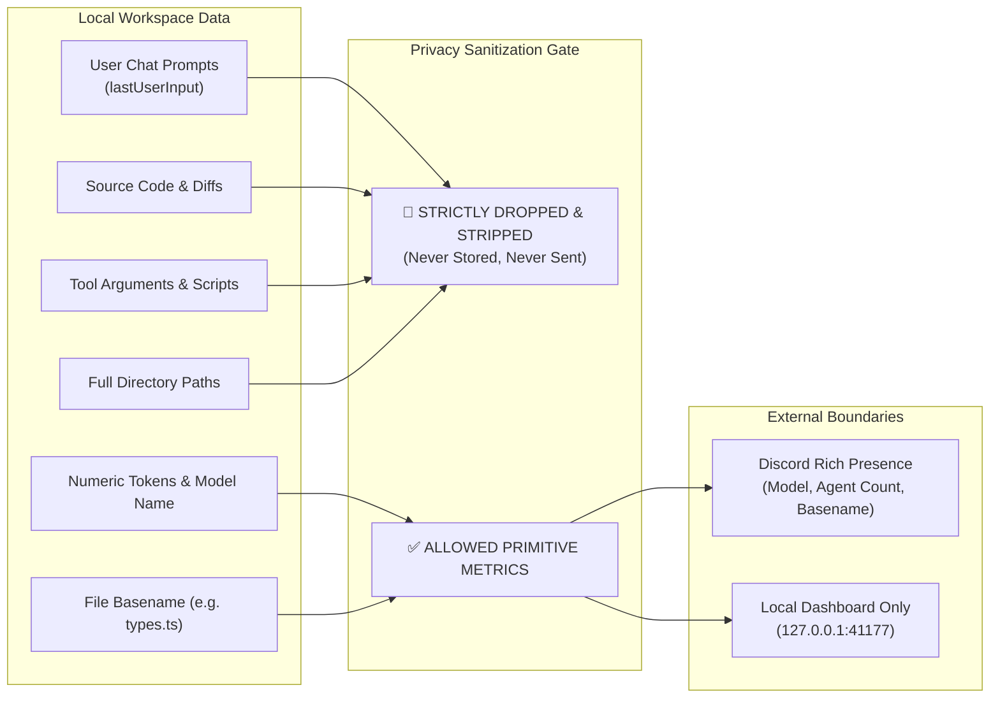

# Antigravity Presence

<p align="center">
  
</p>

<p align="center">
  <strong>Native Discord Rich Presence & Real-Time Observability Companion for Google Antigravity IDE</strong>
</p>

<p align="center">
  <a href="#key-features">Key Features</a> •
  <a href="#how-it-works-architecture-infographics">How It Works (Infographics)</a> •
  <a href="#installation--setup">Installation</a> •
  <a href="#dual-mode-presence">Dual-Mode Presence</a> •
  <a href="#local-dashboard">Local Dashboard</a> •
  <a href="#privacy--security">Privacy & Security</a> •
  <a href="#configuration">Configuration</a>
</p>

<p align="center">
  
  
  
  
  
</p>

---

## Overview

**Antigravity Presence** is an executive-grade, privacy-first companion extension designed specifically for **Google Antigravity IDE**. It seamlessly connects your local Antigravity workspaces to Discord Rich Presence while hosting a dedicated local usage dashboard (`http://127.0.0.1:41177`) with exact token analytics, per-model consumption tracking, and interactive conversation inspection.

Whether your autonomous agents are refactoring codebases, running build tests, or you are manually editing files, Antigravity Presence dynamically broadcasts your activity to Discord with zero lag, zero performance overhead, and zero privacy leaks.

---

## Key Features

- **⚡ 100% Native & Hookless**: Runs entirely within Antigravity IDE as a standard extension. No external daemons required, no fragile CLI hooks in `hooks.json`, and zero native C++ runtime dependencies.
- **👑 Multi-Window Leader Election**: Seamlessly handles multiple open Antigravity IDE windows. Exactly one window acts as the Leader managing the Discord IPC connection and hosting the local dashboard, while Follower windows synchronize editor activity with zero conflicts.
- **🛡️ Bullet-Proof Dual-Mode Presence**:
  - **AI Agent Mode** *(Priority)*: Displays real-time active agent count (`1 AI agent active`), model names (`Gemini 3.8 Flash`, `Gemini 4 Argon`), and continuous session elapsed time.
  - **Manual Coding Mode** *(Fallback)*: When agents are idle, automatically reflects your active file editing (`Editing types.ts • TypeScript — Line 42 of 150`).
  - **Idle in Antigravity Mode**: Maintains your session timer continuously without resetting to `0:00`.
- **📊 Real-Time Local Observability Dashboard (`http://127.0.0.1:41177`)**:
  - **Executive OLED Spatial UI**: Designed according to Linear / Apple-grade craft with double-bezel cards, Geist typography, and Minecraft Seven pixel accents.
  - **Click-to-Inspect Conversation Drawer**: Click any conversation to slide open its live agent status, active tool name (`⚡ run_command`, `⚡ edit_file`), token breakdown, and event timeline.
  - **Per-Model Token Breakdown**: Compares token consumption between Gemini 3.8 Flash, Gemini 4 Argon, Claude Sonnet, etc.
  - **Interactive Daily SVG Graphs**: Vector stacked bar chart tracking Input, Context Cache Read, and Output tokens over the past 14 days with interactive hover tooltips.
- **💾 Zero-Loss Persistent Token Storage**:
  - Stores cumulative token metrics and turn watermarks in `~/.gemini/antigravity/presence-tokens.json` with atomic disk writes.
  - Preserves token history, model distribution, and daily graphs across restarts.
- **🔒 Zero-Trust Privacy Guarantees**:
  - 100% local processing (`127.0.0.1` only). Source code, user prompts, command arguments, and workspace paths never leave your computer.

---

## How It Works: Architecture Infographics

### 1. High-Level System Architecture

The following infographic illustrates how Antigravity Presence coordinates between your IDE workspaces, local logs, Discord IPC, and the dashboard:



---

### 2. Dual-Mode Activity State Machine

Antigravity Presence dynamically prioritizes AI agent activity while ensuring continuous session timing:



---

### 3. Zero-Trust Privacy Boundary

Your private code and chat prompts are completely quarantined at the local boundary:



---

## Installation & Setup

### Option 1: Direct VSIX Install (Recommended)

1. Download the latest `antigravity-presence-1.0.0.vsix` from [Releases](https://github.com/itsjamiedev/Antigravity-Discord-RPC-/releases).
2. Install via Antigravity IDE terminal:
   ```bash
   antigravity-ide --install-extension antigravity-presence-1.0.0.vsix --force
   ```
   *Or press `Ctrl+Shift+P` -> `Extensions: Install from VSIX...` and select the file.*

3. Antigravity Presence activates automatically! Click the status bar pill in the bottom-left corner to open your dashboard.

---

### Option 2: Build from Source

```bash
# Clone the repository
git clone https://github.com/itsjamiedev/Antigravity-Discord-RPC-.git
cd Antigravity-Discord-RPC-

# Install dependencies and build extension bundle
npm install
npm test
npm run build

# Package the extension
npm run package
```

---

## Dual-Mode Presence

Antigravity Presence transitions smoothly between three modes:

| Presence Mode | Discord Headline (Details) | Discord Subline (State) | Large Image / Small Image |
| :--- | :--- | :--- | :--- |
| **AI Agent Mode** | `1 AI agent active` *(or N agents)* | `Gemini 3.8 Flash` | `antigravity_logo` + `robot` badge |
| **Manual Coding Mode** | `Editing presence-manager.ts` | `TypeScript — Line 42 of 150` | `antigravity_logo` + language icon |
| **Idle in Antigravity** | `Idle` | `In Antigravity IDE` | `antigravity_logo` |

> **Note on Session Timer:** Unlike other presence tools, Antigravity Presence maintains a continuous session elapsed timer (`0:45:12 elapsed`) across all mode transitions and agent turns. The timer does not reset to `0:00` until you completely shut down Google Antigravity IDE.

---

## Local Dashboard (`http://127.0.0.1:41177`)

Open **`http://127.0.0.1:41177`** in any browser to access the local observability suite:

- **Overview Tab**: Live status of active agents, total session tokens, models in use, dual-mode editor activity, and active sessions.
- **Agents Tab**: Full table of discovered agent conversations across all workspaces.
- **Models & Tokens Tab**: Visual cards detailing tokens consumed per model (`Gemini 3.8 Flash`, `Gemini 4 Argon`, `Claude Sonnet 3.5`) with segmented progress bars.
- **Conversations Tab**: Complete conversation history with 1-click inspect drawers.
- **Analytics Graphs Tab**: Multi-layer stacked SVG bar chart tracking 14-day token consumption (Input, Context Cache Read, and Output) with hover tooltips.
- **Settings Tab**: Instant toggles for privacy and rich presence customization.

---

## Configuration Settings

Customize Antigravity Presence via **Settings (`Ctrl+,`)** -> search for `Antigravity Presence`:

| Setting | Default | Description |
| :--- | :---: | :--- |
| `antigravityPresence.disableRichPresence` | `false` | Turn Discord Rich Presence on or off without disabling the local dashboard. |
| `antigravityPresence.enableManualEditsPresence` | `true` | Show file editing presence when AI agents are idle. |
| `antigravityPresence.hideFileNamesInManualEdits` | `false` | Mask file names for privacy (displays `"Coding in TypeScript"` instead of file name). |
| `antigravityPresence.hideModels` | `false` | Hide specific AI model names on Discord (displays `"AI Agent"`). |
| `antigravityPresence.hideTokens` | `true` | Keep token metrics private to your local dashboard (hidden from Discord). |

---

## Privacy & Security

Antigravity Presence is built with **zero-trust local isolation**:
- **100% Localhost (`127.0.0.1`)**: Does not send data to any external server.
- **No Prompt or Code Logging**: Prompts, bash commands, file diffs, and tool arguments are never read, stored, or sent.
- **Full Privacy Policy**: Read our detailed [PRIVACY.md](PRIVACY.md) for data guarantees.

---

## License

Antigravity Presence is free, open-source software licensed under the **[MIT License](LICENSE)**.
